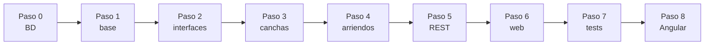

# Guía completa paso a paso: backend de «Arena Sur» (arriendo de canchas)

> Java 21 · Spring Boot 3.5 · Spring MVC · Spring Data JPA · Thymeleaf · PostgreSQL · **Java puro, sin Lombok**.
> Partes de `canchas-backend-base` (proyecto que ya compila y arranca) y lo completas paso a paso hasta tener `canchas-backend`.
> **Cada paso termina en: compilar → levantar → verificar.** El proyecto debe poder arrancar al terminar cada paso.
> Es la misma forma de trabajo de la guía del Tablero Kanban (`clase-03-crud/docs`).

## Mapa del proceso

| Paso | Qué haces | Paquete | Verificas |
|---|---|---|---|
| 0 | Preparar entorno y **PostgreSQL**: crear base, usuario y variables | `crear-bd.sql`, Docker o pgAdmin | `psql` conecta con `canchas` |
| 1 | Levantar el base, ver cómo conecta a PostgreSQL y revisar las tablas | `application.yml` | `\dt` muestra 3 tablas y 5 canchas |
| 2 | Interfaces del service | `service` | Compila |
| 3 | Service de canchas | `service.impl` | Spring inyecta el bean |
| 4 | Service de arriendos (las reglas) | `service.impl` | Arranca sin errores |
| 5 | Controllers REST | `controller` | Swagger: probar los endpoints, incluido el 409 |
| 6 | Controllers web (Thymeleaf) | `controller.web` | Recorrer las pantallas a 360, 768 y 1280 px |
| 7 | Pruebas | `src/test` | `.\mvnw.cmd test` en verde |
| 8 | Conectar Angular (opcional) | `canchas-frontend` | App en `http://localhost:4202` |



## Qué ya viene hecho en el base

| Paquete | Contenido | Para qué sirve |
|---|---|---|
| `enums` | `Deporte`, `EstadoArriendo` | Valores fijos |
| `entity` | `Cancha`, `Arrendatario`, `Arriendo` | Tablas (JPA) |
| `repository` | 3 repositories | Consultas a la base (Spring Data) |
| `dto` | `*Request`, `*Response`, `Validaciones` | Datos de entrada y salida |
| `exception` | `ReglaNegocioException`, `RecursoNoEncontradoException`, `GlobalExceptionHandler` | Errores → HTTP |
| `config` | `DatosIniciales` | Datos de ejemplo |
| `controller.web.form` | `ArriendoForm`, `EditarArriendoForm`, `CanchaForm` | Formularios de Thymeleaf |
| `resources/templates` y `static/web.css` | 8 plantillas HTML responsivas | La vista |

**Tu trabajo:** los paquetes `service`, `service.impl`, `controller` y `controller.web`.

---

## Fase de análisis: casos de uso (antes de construir)


*(Detalle y teoría en [17 · Casos de uso](17-casos-de-uso.md).)*

- Los **actores** (los monitos) son el **Arrendatario** y el **Administrador**; están fuera del sistema.
- Cada **óvalo principal** se convierte en **un endpoint** y **un método del service**.
- **«include» = siempre** (*Arrendar* siempre valida el horario). **«extend» = a veces** (*Rechazar: horario ocupado* solo si ya está arrendado).
- Los óvalos *include* y *extend* son **reglas de negocio**: vivirán en el **Service**.

| Caso de uso | Endpoint REST | Página web | Método del service |
|---|---|---|---|
| CU-01 Consultar disponibilidad | `GET /api/disponibilidad?fecha=` | `/web/disponibilidad` | `consultarDisponibilidad()` |
| CU-02 Arrendar | `POST /api/arriendos` | `/web/arrendar` | `crear()` |
| CU-03 Ver mis arriendos | `GET /api/arriendos?email=` | `/web/mis-arriendos` | `listarPorEmail()` |
| CU-04 Modificar | `PUT /api/arriendos/{id}` | `/web/arriendos/{id}/editar` | `modificar()` |
| CU-05 Cancelar | `PATCH /api/arriendos/{id}/cancelacion` | `/web/arriendos/{id}/cancelar` | `cancelar()` |
| CU-06 Administrar canchas | `/api/canchas` | `/web/admin/canchas` | `CanchaService` |
| CU-07 Ver y cancelar (admin) | `/api/admin/arriendos` | `/web/admin/arriendos` | `listarAgenda()` · `cancelarComoAdmin()` |

Cada caso de uso termina siendo **un método del service** y **un endpoint o una ruta web**. Las reglas RN-01 a RN-05 ([`00-requerimientos.md`](00-requerimientos.md)) viven en el service.

---

## Teoría previa (léela antes de empezar)

> **Para profundizar:** [13 · MVC en capas](13-teoria-mvc.md) · [14 · Patrones y SOLID](14-patrones-y-solid.md) · [15 · UML de clases](15-uml-clases.md) · [16 · UML de secuencia](16-uml-secuencia.md) · [17 · Casos de uso](17-casos-de-uso.md) · [12 · Modelo de base de datos](12-modelo-base-de-datos.md) · [18 · Git](18-git-subir-proyecto.md)

### Vocabulario Java y Spring

| Término | Qué es | Ejemplo en el proyecto |
|---|---|---|
| **package** | Carpeta lógica que agrupa clases | `cl.ipss.canchas.service` |
| **interface** | Contrato: qué métodos existen, sin implementarlos | `ArriendoService` |
| **record** | Clase inmutable para transportar datos | `ArriendoRequest` |
| **annotation** | Etiqueta `@Algo` que da instrucciones al framework | `@Service`, `@Transactional` |
| **bean** | Objeto que Spring crea y administra | `ArriendoServiceImpl` |
| **inyección de dependencias** | Spring entrega al constructor lo que la clase necesita | `public ArriendoServiceImpl(ArriendoRepository arriendos, ...)` |
| **transacción** | Grupo de operaciones: se guardan todas o ninguna | `@Transactional` |
| **DTO** | Objeto que viaja entre capas sin exponer la entidad | `ArriendoResponse` |

### Las capas (MVC)

```
Controller  →  Service (interfaz)  →  Repository  →  Entity
```

- **Controller:** recibe la petición, valida con `@Valid`, llama al service y elige la respuesta. **No decide reglas.**
- **Service:** aquí viven las reglas de negocio. No sabe nada de HTTP ni de HTML.
- **Repository:** habla con la base. Con Spring Data basta declarar el método (`existsByCanchaIdAndFechaAndHoraAndEstado`) y Spring escribe el SQL.
- **Entity:** la tabla hecha clase.

### Códigos HTTP que usarás

| Código | Cuándo |
|---|---|
| **200** | Se leyó o modificó bien |
| **201** | Se creó algo (`POST`) |
| **400** | Datos inválidos (falló `@Valid`) |
| **404** | No existe (o no es tuyo) |
| **409** | Se rompió una regla de negocio (horario ocupado, cancha inactiva...) |

### Post / Redirect / Get (páginas web)

Todo `POST` exitoso termina en `return "redirect:..."`. Así, si la persona refresca el navegador, repite el `GET` y no el `POST` (no se arrienda dos veces). Los mensajes viajan en *flash attributes*. Si hay errores no se redirige: se devuelve la misma vista para conservar lo escrito.

---

## Paso 0 · Preparar el entorno y la base de datos

### Requisitos

| Herramienta | Versión | Comprobar |
|---|---|---|
| JDK | **21** | `java -version` |
| PostgreSQL | 18 (o Docker Desktop) | `psql --version` |
| pgAdmin (opcional) | el que trae PostgreSQL | — |
| IDE | IntelliJ, VS Code o Eclipse | — |

> **Windows:** si `java -version` muestra otra versión (p. ej. 1.8), apunta `JAVA_HOME` a un JDK 21 en la misma terminal:
> ```powershell
> $env:JAVA_HOME = "C:\ruta\a\jdk-21"
> $env:Path = "$env:JAVA_HOME\bin;$env:Path"
> ```

### Qué necesita el proyecto de PostgreSQL

| Dato | Valor por defecto | Variable de entorno |
|---|---|---|
| Base de datos | `canchas_db` | `DB_NAME` |
| Usuario | `canchas` | `DB_USER` |
| Clave | `canchas` | `DB_PASSWORD` |
| Servidor | `localhost` | `DB_HOST` |
| Puerto | `5432` | `DB_PORT` |

Las **tablas no las creas tú**: las crea Hibernate al arrancar (`ddl-auto: update`) y los datos de ejemplo los carga `DatosIniciales`. Tú solo necesitas **una base vacía y un usuario con permisos**.

### 1. Crear la base de datos (elige UNA de las tres formas)

**Forma A · Con Docker** (no necesitas instalar PostgreSQL). Desde la carpeta del proyecto:

```powershell
docker compose up -d
```

Levanta PostgreSQL 18 con la base `canchas_db`, el usuario `canchas` y la clave `canchas` ya creados. Para ver que está corriendo: `docker ps`. Para apagarlo: `docker compose down` (con `-v` borra también los datos).

**Forma B · Con el script `crear-bd.sql`** (PostgreSQL instalado en tu equipo). Hace **todo de una vez**: crea (o actualiza) el usuario, crea la base si no existe y da los permisos. Se puede ejecutar varias veces sin errores. Ejecútalo como `postgres` desde la carpeta del proyecto:

```powershell
psql -U postgres -h localhost -p 5432 -f crear-bd.sql
```

> Usa comandos propios de `psql` (`\gexec`, `\connect`), por eso se ejecuta con `psql` y **no** en el Query Tool de pgAdmin. Si prefieres pgAdmin, usa la Forma C.

El script `crear-bd.sql` está en la raíz del proyecto (junto al `pom.xml`).

**¿Por qué hace falta `GRANT ALL ON SCHEMA public`?** Desde PostgreSQL 15 los usuarios normales ya no pueden crear tablas en el esquema `public` por defecto. Sin ese permiso Hibernate fallaría con *permission denied for schema public* al crear las tablas.

**Forma C · Con pgAdmin.**

1. Clic derecho en *Databases → Create → Database…* → nombre `canchas_db` → *Save*.
2. Clic derecho sobre `canchas_db` → *Query Tool*, pega este script y ejecútalo con **F5**:

```sql
-- Crea el usuario (o le actualiza la clave si ya existe)
DO $$
BEGIN
    IF NOT EXISTS (SELECT FROM pg_roles WHERE rolname = 'canchas') THEN
        CREATE USER canchas WITH PASSWORD 'canchas';
    ELSE
        ALTER USER canchas WITH PASSWORD 'canchas';
    END IF;
END
$$;

-- Lo hace dueño de la base: así Hibernate puede crear las tablas
ALTER DATABASE canchas_db OWNER TO canchas;
GRANT ALL PRIVILEGES ON DATABASE canchas_db TO canchas;
GRANT ALL ON SCHEMA public TO canchas;
```

> ⚠️ **Los dos pasos (crear la base Y ejecutar el script del usuario) son obligatorios.** Si solo creas la base `canchas_db` desde pgAdmin y no ejecutas el script, **el usuario `canchas` no existe** y el backend falla al arrancar con `la autentificación password falló para el usuario "canchas"` (ver el diagnóstico más abajo).

> **Si tienes PostgreSQL 14 y 18 instalados**, uno usa el puerto 5432 y el otro el 5433. Para saber a cuál te conectaste: `psql -U postgres -h localhost -p 5433 -c "SHOW server_version;"`. ¿Cuál es mi puerto? En pgAdmin: clic derecho sobre el servidor → *Properties → Connection → Port*, o en el Query Tool: `SHOW port;`.

**✅ Verificar (las dos cosas, con el usuario del proyecto):**

```powershell
# 1) ¿existe la base? (como postgres)
psql -U postgres -h localhost -p 5432 -c "\l"
# 2) ¿puede entrar el usuario que usará el backend? (clave: canchas)
psql -U canchas -h localhost -p 5432 -d canchas_db -c "select current_user;"
```

La segunda prueba es la **importante**: si responde `canchas`, el backend también podrá conectarse. Si dice `password authentication failed`, **no levantes el backend todavía**: ve al diagnóstico de más abajo.

### 2. ¿Con qué usuario se conecta el backend?

Crear la base **no define el usuario**: el usuario es el de la conexión con la que el backend entra a PostgreSQL.

**Opción 1 · Usar el usuario del proyecto (`canchas` / `canchas`).** Es lo habitual (un usuario por aplicación) y ya lo dejan creado la Forma A, B o C. No tienes que definir nada.

**Opción 2 · Usar el mismo usuario con el que entras a pgAdmin** (casi siempre `postgres`, con la clave que definiste al instalar). Como el proyecto trae por defecto `canchas`, aquí **sí** debes indicar usuario y clave antes de levantar el backend:

```powershell
$env:DB_USER = "postgres"
$env:DB_PASSWORD = "la_clave_de_postgres"
# $env:DB_PORT = "5433"     # solo si tu PostgreSQL no usa el 5432
```

**¿Cómo saber si el usuario y la clave están bien?** Antes de levantar el backend prueba la conexión:

```powershell
psql -U canchas -h localhost -p 5432 -d canchas_db -c "SELECT current_user;"
```

Si pide clave y responde `canchas`, el backend podrá conectarse igual. Si dice *password authentication failed*, el usuario o la clave no coinciden.

### 3. Las 3 formas de configurar usuario, clave y puerto

**Forma 1 · Editar `application.yml`** (la más simple, pero cambia un archivo del proyecto):

```yaml
spring:
  datasource:
    username: tu_usuario
    password: tu_clave
```

**Forma 2 · Variables de entorno en la terminal** (PowerShell):

```powershell
$env:DB_USER = "postgres"
$env:DB_PASSWORD = "tu_clave"
# $env:DB_PORT = "5433"     # solo si tu PostgreSQL no usa el 5432
.\mvnw.cmd spring-boot:run
```

**Forma 3 · Variables en el IDE** (no ensucia el proyecto):

- IntelliJ: *Run → Edit Configurations → Environment variables* → `DB_USER=...;DB_PASSWORD=...`
- VS Code: en `launch.json`, la clave `"env": { "DB_USER": "...", "DB_PASSWORD": "..." }`
- Eclipse: *Run Configurations → Environment*.

Variables disponibles: `DB_HOST, DB_PORT, DB_NAME, DB_USER, DB_PASSWORD, SERVER_PORT, LOG_LEVEL_APP`.

### Errores de conexión comunes

| Mensaje | Causa | Solución |
|---|---|---|
| `FATAL: la autentificación password falló para el usuario "canchas"` (en inglés: `password authentication failed for user "canchas"`, código `28P01`) | **Tres causas posibles** (PostgreSQL da el mismo mensaje en las tres, por seguridad): 1) **el usuario `canchas` no existe** (solo creaste la base); 2) existe pero con **otra clave**; 3) te conectas a **otro servidor o puerto** (por ejemplo PostgreSQL 14 en vez del 18) | Sigue el **diagnóstico de abajo** |
| `role "canchas" does not exist` | El usuario no existe (este mensaje solo aparece en algunas configuraciones de PostgreSQL; lo normal es el de arriba) | Ejecuta la Forma B o C (o usa `postgres` con la Opción 2) |
| `database "canchas_db" does not exist` | No creaste la base, o está mal escrito `DB_NAME` | Crea `canchas_db` (punto 1) |
| `Connection refused` | Puerto equivocado o PostgreSQL apagado | Verifica el puerto con `SHOW port;` y defínelo con `DB_PORT`; revisa que el servicio (o `docker compose up -d`) esté en ejecución |
| `permission denied for schema public` | El usuario no puede crear tablas (PostgreSQL 15+) | Conectado a `canchas_db`: `ALTER DATABASE canchas_db OWNER TO canchas;` y `GRANT ALL ON SCHEMA public TO canchas;` |
| `Port 8085 was already in use` | Otro proceso (por ejemplo la versión terminada del proyecto) usa el puerto | Ciérralo o define `SERVER_PORT` |
| Cambié el `application.yml` y sigue igual | La aplicación no se reinició | Detén y vuelve a ejecutar |
| En otra terminal vuelve a fallar | Las variables `$env:` valen solo para la terminal donde se definieron | Defínelas de nuevo, o usa la Forma 1 o la Forma 3 |

### 🔧 Diagnóstico: "la autentificación password falló para el usuario canchas"

El mensaje viene de **PostgreSQL**, no de Java: el backend llegó al servidor y este rechazó el usuario o la clave. Sigue estos 4 pasos **en orden**:

**1) ¿A qué servidor te conectas?** Si tienes más de un PostgreSQL instalado, el usuario puede haberse creado en otro.

```powershell
psql -U postgres -h localhost -p 5432 -c "SHOW server_version;" -c "SHOW port;"
```

Debe ser la versión que usas (por ejemplo 18) y el puerto que usa el backend (`DB_PORT`, por defecto 5432).

**2) ¿Existe el usuario `canchas`?** Lista los usuarios del servidor:

```powershell
psql -U postgres -h localhost -p 5432 -c "\du"
```

Si **no aparece `canchas`** en la lista, esa es la causa: solo creaste la base. Créalo ahora (como `postgres`):

```powershell
psql -U postgres -h localhost -p 5432 -f crear-bd.sql
```

(o, en pgAdmin, el script de la Forma C en el Query Tool de `canchas_db`, con **F5**).

**3) Si `canchas` existe, repón su clave** (así queda `canchas` / `canchas`, como espera el proyecto):

```powershell
psql -U postgres -h localhost -p 5432 -c "ALTER USER canchas WITH PASSWORD 'canchas';"
```

**4) Comprueba la conexión con ese usuario** antes de levantar el backend:

```powershell
psql -U canchas -h localhost -p 5432 -d canchas_db -c "select current_user;"
```

Debe pedir la clave y responder `canchas`. Si responde, `.\mvnw.cmd spring-boot:run` conectará.

**¿Prefieres no crear el usuario `canchas`?** Usa el de pgAdmin (casi siempre `postgres`) definiendo las variables **antes** de levantar el backend (Opción 2 del punto "¿Con qué usuario se conecta el backend?"). **Ojo:** las variables `$env:` valen solo para la terminal donde las definiste. Si levantas el proyecto desde el **IDE** (IntelliJ, Eclipse, VS Code) o desde otra terminal, defínelas en la configuración de ejecución del IDE (Forma 3).

### ✅ Verificar

```powershell
$env:PGPASSWORD = "canchas"
psql -U canchas -h localhost -p 5432 -d canchas_db -c "select 1"
```

Debe responder `1`.

---

## Paso 1 · Levantar el proyecto base y verificar la conexión

Abre la carpeta `canchas-backend-base`. Ya trae el `pom.xml`, el `application.yml`, el modelo, los repositories, los DTO, las excepciones, los datos iniciales y las plantillas.

### `application.yml`: cómo se conecta a PostgreSQL

```yaml
server:
  port: ${SERVER_PORT:8085}
  servlet:
    session:
      tracking-modes: cookie   # evita ";jsessionid=..." en las URLs de las redirecciones

spring:
  application:
    name: canchas-backend
  datasource:
    # Cambia host/puerto/usuario/clave con variables de entorno si tu PostgreSQL es distinto
    url: jdbc:postgresql://${DB_HOST:localhost}:${DB_PORT:5432}/${DB_NAME:canchas_db}
    username: ${DB_USER:canchas}
    password: ${DB_PASSWORD:canchas}
  jpa:
    open-in-view: false        # las consultas se resuelven en el service (transacción), no durante el render de la vista
    hibernate:
      ddl-auto: update         # Hibernate crea/actualiza las tablas a partir de las entidades (suficiente para esta evaluación)
    properties:
      hibernate:
        format_sql: true
  thymeleaf:
    cache: false               # al editar una plantilla se ve el cambio sin reiniciar (solo para desarrollo)

# -------------------------------------------------
# LOGGING (SLF4J + Logback, ya incluidos en Spring Boot; sin Lombok)
# -------------------------------------------------
logging:
  file:
    name: logs/${spring.application.name}.log
  level:
    root: INFO
    cl.ipss: ${LOG_LEVEL_APP:INFO}   # DEBUG agrega más detalle (p. ej. los errores 404/409 de la API)
    org.hibernate.SQL: DEBUG         # muestra el SQL que ejecuta Hibernate
```

| Línea | Qué hace |
|---|---|
| `url: jdbc:postgresql://${DB_HOST:localhost}:${DB_PORT:5432}/${DB_NAME:canchas_db}` | Dirección de la base. `${DB_PORT:5432}` significa "usa la variable `DB_PORT` y, si no existe, 5432" |
| `username` y `password` | Usuario y clave (por defecto `canchas` / `canchas`) |
| `ddl-auto: update` | **Hibernate crea o ajusta las tablas** a partir de las entidades. Por eso no hay scripts de tablas |
| `open-in-view: false` | Las consultas ocurren en el service, no mientras se dibuja la vista |
| `org.hibernate.SQL: DEBUG` | Muestra en la consola el SQL que se ejecuta (`create table…`, `insert…`, `select…`) |

> `ddl-auto: update` es cómodo para la evaluación. En un sistema real las tablas se crean con **migraciones** (por ejemplo Flyway) para controlar los cambios de esquema; la versión extendida del proyecto (`_version-extendida`) las usa.

### Levantar

```powershell
cd canchas-backend-base
.\mvnw.cmd spring-boot:run
```

**Qué debe pasar:** arranca sin errores aunque falten services y controllers. En la consola ves sentencias `create table cancha`, `create table arrendatario` y `create table arriendo`, y el mensaje `--- datos iniciales cargados: 5 canchas ---`.

### ✅ Verificar la base de datos

**Con `psql`:**

```powershell
$env:PGPASSWORD = "canchas"
psql -U canchas -h localhost -p 5432 -d canchas_db -c "\dt"
psql -U canchas -h localhost -p 5432 -d canchas_db -c "select id, nombre, deporte, tarifa_hora, activa from cancha order by id;"
psql -U canchas -h localhost -p 5432 -d canchas_db -c "select id, cancha_id, fecha, hora_inicio, precio, estado from arriendo;"
```

Debes ver las 3 tablas (`cancha`, `arrendatario`, `arriendo`), 5 canchas y 2 arriendos de mañana.

**Con pgAdmin:** *Servers → PostgreSQL → Databases → canchas_db → Schemas → public → Tables*. Clic derecho sobre una tabla → *View/Edit Data → All Rows*.

> Estas instrucciones y el comportamiento de `ddl-auto: update` sobre PostgreSQL **no se pudieron comprobar en este equipo** (sin PostgreSQL instalado); el proyecto se verificó con una base H2 en memoria. Si algo falla al crear las tablas, revisa la tabla de errores comunes de arriba y pega el mensaje.

**Qué leer antes de seguir** (10 minutos):

| Archivo | Qué mirar |
|---|---|
| `entity/Arriendo.java` | Constantes `HORA_MINIMA` y `HORA_MAXIMA`; métodos `puedeModificarse()`, `reprogramar()`, `cancelar()` |
| `repository/ArriendoRepository.java` | Qué consultas ya existen: `existsBy…`, `findByFechaAndEstado`, `findByArrendatarioEmail…` |
| `dto/ArriendoRequest.java` y `ArriendoResponse.java` | Qué entra y qué sale; `ArriendoResponse.from(entidad)` |
| `exception/` | `ReglaNegocioException` (409) y `RecursoNoEncontradoException` (404) |

Detén la aplicación (Ctrl+C) antes de seguir editando.

---

## Paso 2 · Interfaces del service

**Objetivo:** escribir el **contrato**: qué puede hacer cada caso de uso, sin implementarlo. Los controllers dependerán de estas interfaces.

Crea en `cl.ipss.canchas.service`:

### `CanchaService.java`

```java
package cl.ipss.canchas.service;

import cl.ipss.canchas.dto.CanchaRequest;
import cl.ipss.canchas.dto.CanchaResponse;

import java.util.List;

/**
 * Casos de uso de la gestión de canchas (CRUD del administrador).
 * Los controllers dependen de esta interfaz, no de la implementación: así se pueden probar con un mock.
 */
public interface CanchaService {

    /** Todas las canchas, activas e inactivas, ordenadas por nombre. */
    List<CanchaResponse> listar();

    /** Una cancha por id. @throws cl.ipss.canchas.exception.RecursoNoEncontradoException si no existe */
    CanchaResponse obtener(Long id);

    /** Crea una cancha activa. @throws cl.ipss.canchas.exception.ReglaNegocioException si el nombre ya existe */
    CanchaResponse crear(CanchaRequest request);

    /** Edita nombre, deporte y tarifa. Los arriendos ya hechos conservan el precio que pagaron. */
    CanchaResponse actualizar(Long id, CanchaRequest request);

    /** Activa o desactiva una cancha (borrado lógico). */
    CanchaResponse cambiarEstado(Long id, boolean activa);
}
```

### `ArriendoService.java`

```java
package cl.ipss.canchas.service;

import cl.ipss.canchas.dto.ArriendoRequest;
import cl.ipss.canchas.dto.ArriendoResponse;
import cl.ipss.canchas.dto.CambioArriendoRequest;
import cl.ipss.canchas.dto.DisponibilidadResponse;

import java.time.LocalDate;
import java.util.List;

/**
 * Casos de uso de los arriendos: consultar disponibilidad, arrendar, ver, modificar y cancelar.
 * Aquí viven las reglas de negocio; los controllers solo reciben la petición y devuelven la respuesta.
 */
public interface ArriendoService {

    /** Para cada cancha activa, las horas libres de la fecha. Excluye horas ocupadas y horas que ya pasaron. */
    List<DisponibilidadResponse> consultarDisponibilidad(LocalDate fecha);

    /**
     * Crea un arriendo CONFIRMADO.
     * @throws cl.ipss.canchas.exception.ReglaNegocioException si la cancha está inactiva, la fecha ya pasó
     *         o el horario está ocupado
     */
    ArriendoResponse crear(ArriendoRequest request);

    /** Un arriendo del cliente. @throws cl.ipss.canchas.exception.RecursoNoEncontradoException si no existe o es de otra persona */
    ArriendoResponse obtener(Long id, String email);

    /** Arriendos de una persona (por email), del más reciente al más antiguo. */
    List<ArriendoResponse> listarPorEmail(String email);

    /** Cambia cancha, fecha y/u hora de un arriendo confirmado que aún no comienza. */
    ArriendoResponse modificar(Long id, CambioArriendoRequest request);

    /** El cliente cancela su arriendo (el horario queda libre). */
    ArriendoResponse cancelar(Long id, String email);

    /** Agenda del administrador. Con fecha = solo ese día; con fecha null = todos los arriendos. */
    List<ArriendoResponse> listarAgenda(LocalDate fecha);

    /** El administrador cancela cualquier arriendo confirmado, sin verificar el email. */
    ArriendoResponse cancelarComoAdmin(Long id);
}
```

**Por qué interfaz:** el controller y las pruebas dependen del contrato; se puede cambiar la implementación o simularla con Mockito sin tocar nada más.

**Verificas:** `.\mvnw.cmd compile` termina en `BUILD SUCCESS`.

---

## Paso 3 · `CanchaServiceImpl` (CRUD de canchas)

**Objetivo:** implementar `CanchaService`. Es el service más simple y sirve para aprender el patrón antes de las reglas de arriendo.

Puntos clave:

- `@Service` registra la clase como bean; `@Transactional` hace que cada método sea una transacción (`readOnly = true` en las consultas).
- La dependencia llega **por constructor** (sin `@Autowired`).
- *Dirty checking*: en `actualizar` y `cambiarEstado` no se llama a `save`: la entidad está gestionada y JPA hace el `UPDATE` al terminar la transacción.
- Regla RN-06: el nombre de la cancha es único → `existsByNombreIgnoreCase` y, al editar, `existsByNombreIgnoreCaseAndIdNot`.

### 📝 Logs con SLF4J (sin Lombok)

SLF4J es la fachada de logs de Spring Boot. Sin Lombok, cada clase declara su logger **a mano**:

```java
private static final Logger log = LoggerFactory.getLogger(CanchaServiceImpl.class);
```

Criterio del proyecto:

| Dónde | Nivel | Ejemplo |
|---|---|---|
| Service, al **completar** una operación que cambia datos | `info` | `log.info("--- cancha creada: id={} nombre={} ---", id, nombre);` |
| `GlobalExceptionHandler`: 404 y 409 | `debug` | `log.debug("--- regla de negocio: {} ---", e.getMessage());` (no duplica lo que ya dijo el service) |
| `GlobalExceptionHandler`: error inesperado | `error` (con la excepción) | `log.error("--- error inesperado ---", e);` |
| `DatosIniciales` | `info` | `--- datos iniciales cargados: 5 canchas ---` |

Reglas: mensajes entre `--- ... ---`, con `{}` para los valores y **sin datos sensibles** (no registres la clave ni datos personales completos). En este proyecto los mensajes están en español; si tu docente exige inglés (como en el Kanban), cámbialos todos de forma consistente.

El SQL que ejecuta Hibernate también se ve en la consola (`org.hibernate.SQL: DEBUG` en el `application.yml`): útil para comprobar que una consulta hace lo esperado.

Crea `cl.ipss.canchas.service.impl.CanchaServiceImpl`:

```java
package cl.ipss.canchas.service.impl;

import cl.ipss.canchas.dto.CanchaRequest;
import cl.ipss.canchas.dto.CanchaResponse;
import cl.ipss.canchas.entity.Cancha;
import cl.ipss.canchas.exception.RecursoNoEncontradoException;
import cl.ipss.canchas.exception.ReglaNegocioException;
import cl.ipss.canchas.repository.CanchaRepository;
import cl.ipss.canchas.service.CanchaService;
import org.slf4j.Logger;
import org.slf4j.LoggerFactory;
import org.springframework.stereotype.Service;
import org.springframework.transaction.annotation.Transactional;

import java.util.List;

/**
 * Implementación de {@link CanchaService}: CRUD de canchas con sus reglas (nombre único).
 * {@code @Transactional} hace que cada método sea una transacción: si algo falla, no queda nada a medias.
 */
@Service
public class CanchaServiceImpl implements CanchaService {

    private static final Logger log = LoggerFactory.getLogger(CanchaServiceImpl.class);

    private final CanchaRepository canchas;

    /** Inyección por constructor: Spring entrega el repository ya creado (no se usa @Autowired ni Lombok). */
    public CanchaServiceImpl(CanchaRepository canchas) {
        this.canchas = canchas;
    }

    @Override
    @Transactional(readOnly = true)
    public List<CanchaResponse> listar() {
        return canchas.findAllByOrderByNombreAsc().stream().map(CanchaResponse::from).toList();
    }

    @Override
    @Transactional(readOnly = true)
    public CanchaResponse obtener(Long id) {
        return CanchaResponse.from(buscar(id));
    }

    @Override
    @Transactional
    public CanchaResponse crear(CanchaRequest request) {
        String nombre = request.nombre().trim();
        if (canchas.existsByNombreIgnoreCase(nombre)) {
            throw new ReglaNegocioException("Ya existe una cancha llamada '" + nombre + "'");
        }
        Cancha cancha = canchas.save(new Cancha(nombre, request.deporte(), request.tarifaHora()));
        log.info("--- cancha creada: id={} nombre={} ---", cancha.getId(), cancha.getNombre());
        return CanchaResponse.from(cancha);
    }

    @Override
    @Transactional
    public CanchaResponse actualizar(Long id, CanchaRequest request) {
        Cancha cancha = buscar(id);
        String nombre = request.nombre().trim();
        if (canchas.existsByNombreIgnoreCaseAndIdNot(nombre, id)) {
            throw new ReglaNegocioException("Ya existe otra cancha llamada '" + nombre + "'");
        }
        // La entidad está "gestionada": al terminar la transacción JPA detecta el cambio y hace el UPDATE solo.
        cancha.actualizar(nombre, request.deporte(), request.tarifaHora());
        log.info("--- cancha actualizada: id={} ---", id);
        return CanchaResponse.from(cancha);
    }

    @Override
    @Transactional
    public CanchaResponse cambiarEstado(Long id, boolean activa) {
        Cancha cancha = buscar(id);
        cancha.setActiva(activa);
        log.info("--- cancha id={} activa={} ---", id, activa);
        return CanchaResponse.from(cancha);
    }

    private Cancha buscar(Long id) {
        return canchas.findById(id)
                .orElseThrow(() -> new RecursoNoEncontradoException("No existe la cancha con id " + id));
    }
}
```

**Verificas:** `.\mvnw.cmd spring-boot:run` arranca sin errores (Spring inyecta el bean).

---

## Paso 4 · `ArriendoServiceImpl` (las reglas de negocio)

**Objetivo:** el corazón del sistema. Aquí se aplican RN-01 a RN-07.

**Orden sugerido para escribirlo** (compila y levanta tras cada bloque):

| Orden | Bloque | Qué escribes |
|---|---|---|
| 1 | Esqueleto | Clase, logger, 3 repositories por constructor |
| 2 | Búsquedas auxiliares | `normalizar`, `buscarCanchaActiva`, `buscarDelCliente`, `obtenerOCrearArrendatario` |
| 3 | Reglas pequeñas | `yaPaso`, `exigirHorarioValido`, `exigirHorarioLibre`, `exigirModificable` |
| 4 | Consultas | `consultarDisponibilidad`, `obtener`, `listarPorEmail`, `listarAgenda` |
| 5 | Comandos | `crear`, `modificar`, `cancelar`, `cancelarComoAdmin` |

**Ideas que debes entender:**

| Idea | Dónde |
|---|---|
| `crear()` se lee como una receta: cancha activa → horario válido → horario libre → guardar | `crear` |
| Una sola consulta trae los arriendos del día y se agrupan por cancha (evita una consulta por cancha) | `consultarDisponibilidad` |
| Un arriendo ajeno responde **404**, no 403: no se revela que existe | `buscarDelCliente` |
| Al modificar, el horario "libre" ignora al propio arriendo (`excluirId`) | `exigirHorarioLibre` |
| El precio se copia de la tarifa de la cancha en el constructor de `Arriendo` | `Arriendo` (ya hecho) |

Crea `cl.ipss.canchas.service.impl.ArriendoServiceImpl`:

```java
package cl.ipss.canchas.service.impl;

import cl.ipss.canchas.dto.ArriendoRequest;
import cl.ipss.canchas.dto.ArriendoResponse;
import cl.ipss.canchas.dto.CambioArriendoRequest;
import cl.ipss.canchas.dto.CanchaResponse;
import cl.ipss.canchas.dto.DisponibilidadResponse;
import cl.ipss.canchas.entity.Arrendatario;
import cl.ipss.canchas.entity.Arriendo;
import cl.ipss.canchas.entity.Cancha;
import cl.ipss.canchas.enums.EstadoArriendo;
import cl.ipss.canchas.exception.RecursoNoEncontradoException;
import cl.ipss.canchas.exception.ReglaNegocioException;
import cl.ipss.canchas.repository.ArrendatarioRepository;
import cl.ipss.canchas.repository.ArriendoRepository;
import cl.ipss.canchas.repository.CanchaRepository;
import cl.ipss.canchas.service.ArriendoService;
import org.slf4j.Logger;
import org.slf4j.LoggerFactory;
import org.springframework.stereotype.Service;
import org.springframework.transaction.annotation.Transactional;

import java.time.LocalDate;
import java.time.LocalDateTime;
import java.time.LocalTime;
import java.util.List;
import java.util.Map;
import java.util.Set;
import java.util.stream.Collectors;
import java.util.stream.IntStream;

/**
 * Implementación de {@link ArriendoService}. Concentra las reglas de negocio del sistema:
 *
 *  RN-01  Un horario de una cancha no puede arrendarse dos veces (solo cuenta si el arriendo está CONFIRMADO).
 *  RN-02  Solo se arriendan canchas activas.
 *  RN-03  Los bloques son de 1 hora, entre las 08:00 y las 22:00.
 *  RN-04  No se puede arrendar ni mover un arriendo a un horario que ya pasó.
 *  RN-05  Solo se modifica o cancela un arriendo CONFIRMADO que aún no comienza, y solo lo hace su dueño
 *         (identificado por email) o el administrador al cancelar.
 *
 * Cada método de esta clase es una transacción: se guarda todo o no se guarda nada.
 */
@Service
public class ArriendoServiceImpl implements ArriendoService {

    private static final Logger log = LoggerFactory.getLogger(ArriendoServiceImpl.class);

    private final ArriendoRepository arriendos;
    private final CanchaRepository canchas;
    private final ArrendatarioRepository arrendatarios;

    public ArriendoServiceImpl(ArriendoRepository arriendos, CanchaRepository canchas,
                               ArrendatarioRepository arrendatarios) {
        this.arriendos = arriendos;
        this.canchas = canchas;
        this.arrendatarios = arrendatarios;
    }

    // ------------------------------------------------------------------ consultas

    @Override
    @Transactional(readOnly = true)
    public List<DisponibilidadResponse> consultarDisponibilidad(LocalDate fecha) {
        // Una sola consulta trae los arriendos confirmados del día; se agrupan por cancha para saber qué horas están ocupadas.
        Map<Long, Set<Integer>> ocupadasPorCancha = arriendos.findByFechaAndEstado(fecha, EstadoArriendo.CONFIRMADO)
                .stream()
                .collect(Collectors.groupingBy(a -> a.getCancha().getId(),
                        Collectors.mapping(Arriendo::getHora, Collectors.toSet())));

        return canchas.findByActivaTrueOrderByNombreAsc().stream()
                .map(c -> new DisponibilidadResponse(CanchaResponse.from(c),
                        horasLibres(fecha, ocupadasPorCancha.getOrDefault(c.getId(), Set.of()))))
                .toList();
    }

    @Override
    @Transactional(readOnly = true)
    public ArriendoResponse obtener(Long id, String email) {
        return ArriendoResponse.from(buscarDelCliente(id, email));
    }

    @Override
    @Transactional(readOnly = true)
    public List<ArriendoResponse> listarPorEmail(String email) {
        return arriendos.findByArrendatarioEmailOrderByFechaDescHoraDesc(normalizar(email))
                .stream().map(ArriendoResponse::from).toList();
    }

    @Override
    @Transactional(readOnly = true)
    public List<ArriendoResponse> listarAgenda(LocalDate fecha) {
        List<Arriendo> lista = (fecha == null)
                ? arriendos.findAllByOrderByFechaDescHoraDesc()
                : arriendos.findByFechaOrderByHoraAsc(fecha);
        return lista.stream().map(ArriendoResponse::from).toList();
    }

    // ------------------------------------------------------------------ comandos

    @Override
    @Transactional
    public ArriendoResponse crear(ArriendoRequest request) {
        Cancha cancha = buscarCanchaActiva(request.canchaId());                       // RN-02
        exigirHorarioValido(request.fecha(), request.hora());                         // RN-03 y RN-04
        exigirHorarioLibre(cancha.getId(), request.fecha(), request.hora(), null);    // RN-01

        Arrendatario arrendatario = obtenerOCrearArrendatario(request);
        Arriendo arriendo = arriendos.save(new Arriendo(cancha, arrendatario, request.fecha(), request.hora()));

        log.info("--- arriendo creado: id={} cancha={} fecha={} hora={} ---",
                arriendo.getId(), cancha.getNombre(), arriendo.getFecha(), arriendo.getHora());
        return ArriendoResponse.from(arriendo);
    }

    @Override
    @Transactional
    public ArriendoResponse modificar(Long id, CambioArriendoRequest request) {
        Arriendo arriendo = buscarDelCliente(id, request.email());
        exigirModificable(arriendo);                                                  // RN-05

        Cancha cancha = buscarCanchaActiva(request.canchaId());                       // RN-02
        exigirHorarioValido(request.fecha(), request.hora());                         // RN-03 y RN-04
        exigirHorarioLibre(cancha.getId(), request.fecha(), request.hora(), id);      // RN-01 (ignora al propio arriendo)

        // No hace falta llamar a save(): el arriendo está gestionado y JPA hace el UPDATE al terminar la transacción.
        arriendo.reprogramar(cancha, request.fecha(), request.hora());
        log.info("--- arriendo modificado: id={} ---", id);
        return ArriendoResponse.from(arriendo);
    }

    @Override
    @Transactional
    public ArriendoResponse cancelar(Long id, String email) {
        Arriendo arriendo = buscarDelCliente(id, email);
        exigirModificable(arriendo);                                                  // RN-05
        arriendo.cancelar();
        log.info("--- arriendo cancelado por el cliente: id={} ---", id);
        return ArriendoResponse.from(arriendo);
    }

    @Override
    @Transactional
    public ArriendoResponse cancelarComoAdmin(Long id) {
        Arriendo arriendo = arriendos.findById(id)
                .orElseThrow(() -> new RecursoNoEncontradoException("No existe el arriendo con id " + id));
        if (!arriendo.estaConfirmado()) {
            throw new ReglaNegocioException("El arriendo ya está cancelado");
        }
        arriendo.cancelar();
        log.info("--- arriendo cancelado por el administrador: id={} ---", id);
        return ArriendoResponse.from(arriendo);
    }

    // ------------------------------------------------------------------ reglas (métodos pequeños y con nombre claro)

    /** Horas de inicio del día que no están ocupadas y que aún no han pasado. */
    private List<Integer> horasLibres(LocalDate fecha, Set<Integer> ocupadas) {
        return IntStream.rangeClosed(Arriendo.HORA_MINIMA, Arriendo.HORA_MAXIMA)
                .filter(hora -> !ocupadas.contains(hora) && !yaPaso(fecha, hora))
                .boxed()
                .toList();
    }

    /** RN-03 y RN-04: hora dentro del horario del recinto y no pasada. */
    private void exigirHorarioValido(LocalDate fecha, int hora) {
        if (hora < Arriendo.HORA_MINIMA || hora > Arriendo.HORA_MAXIMA) {
            throw new ReglaNegocioException("El horario de atención es de 08:00 a 22:00");
        }
        if (yaPaso(fecha, hora)) {
            throw new ReglaNegocioException("No se puede arrendar un horario que ya pasó");
        }
    }

    /** RN-01: lanza error si otro arriendo CONFIRMADO ocupa ese horario (excluyendo a {@code excluirId} si viene). */
    private void exigirHorarioLibre(Long canchaId, LocalDate fecha, int hora, Long excluirId) {
        boolean ocupado = (excluirId == null)
                ? arriendos.existsByCanchaIdAndFechaAndHoraAndEstado(canchaId, fecha, hora, EstadoArriendo.CONFIRMADO)
                : arriendos.existsByCanchaIdAndFechaAndHoraAndEstadoAndIdNot(canchaId, fecha, hora,
                        EstadoArriendo.CONFIRMADO, excluirId);
        if (ocupado) {
            throw new ReglaNegocioException("Ese horario ya está arrendado. Elige otro");
        }
    }

    /** RN-05: el arriendo debe estar confirmado y no haber comenzado. */
    private void exigirModificable(Arriendo arriendo) {
        if (!arriendo.estaConfirmado()) {
            throw new ReglaNegocioException("El arriendo ya está cancelado y no admite cambios");
        }
        if (!arriendo.puedeModificarse()) {
            throw new ReglaNegocioException("El arriendo ya comenzó o terminó: no se puede modificar ni cancelar");
        }
    }

    private boolean yaPaso(LocalDate fecha, int hora) {
        return LocalDateTime.of(fecha, LocalTime.of(hora, 0)).isBefore(LocalDateTime.now());
    }

    // ------------------------------------------------------------------ búsquedas auxiliares

    private Cancha buscarCanchaActiva(Long canchaId) {
        Cancha cancha = canchas.findById(canchaId)
                .orElseThrow(() -> new RecursoNoEncontradoException("No existe la cancha con id " + canchaId));
        if (!cancha.isActiva()) {
            throw new ReglaNegocioException("La cancha '" + cancha.getNombre() + "' está fuera de servicio");
        }
        return cancha;
    }

    /**
     * Busca el arriendo y comprueba que sea de esa persona. Si es de otra, responde "no existe" (404) y no
     * "prohibido": así no se revela que ese arriendo existe.
     */
    private Arriendo buscarDelCliente(Long id, String email) {
        String emailNormalizado = normalizar(email);
        return arriendos.findById(id)
                .filter(a -> a.getArrendatario().getEmail().equals(emailNormalizado))
                .orElseThrow(() -> new RecursoNoEncontradoException("No existe el arriendo " + id + " para ese email"));
    }

    /** Reutiliza al arrendatario si el email ya existe (actualizando sus datos); si no, lo crea. */
    private Arrendatario obtenerOCrearArrendatario(ArriendoRequest request) {
        String email = normalizar(request.email());
        String nombre = request.nombre().trim();
        return arrendatarios.findByEmail(email)
                .map(existente -> {
                    existente.actualizarContacto(nombre, request.telefono());
                    return existente;
                })
                .orElseGet(() -> arrendatarios.save(new Arrendatario(nombre, email, request.telefono())));
    }

    /** El email identifica a la persona: se compara siempre sin espacios y en minúsculas. */
    private String normalizar(String email) {
        return email == null ? "" : email.trim().toLowerCase();
    }
}
```

**Verificas:** arranca sin errores. Las pruebas del Paso 7 comprobarán cada regla.

---

## Paso 5 · Controllers REST

**Objetivo:** exponer los services como API JSON (la que usa Angular). Deben ser **delgados**: `@Valid`, llamar al service y elegir el código HTTP. Nada de repositories ni reglas.

Detalles:

- `@RestController` + `@RequestMapping` agrupan las rutas.
- `@Valid @RequestBody` dispara las validaciones del DTO (si fallan: 400).
- `ResponseEntity.created(uri)` responde **201** con la cabecera `Location`.
- Los errores 404 y 409 los traduce `GlobalExceptionHandler` (ya hecho): el controller no tiene `try/catch`.
- `@DateTimeFormat(iso = DATE)` convierte `2026-12-01` en `LocalDate`.

### `ArriendoRestController.java`

```java
package cl.ipss.canchas.controller;

import cl.ipss.canchas.dto.ArriendoRequest;
import cl.ipss.canchas.dto.ArriendoResponse;
import cl.ipss.canchas.dto.CambioArriendoRequest;
import cl.ipss.canchas.dto.DisponibilidadResponse;
import cl.ipss.canchas.service.ArriendoService;
import jakarta.validation.Valid;
import org.springframework.format.annotation.DateTimeFormat;
import org.springframework.http.ResponseEntity;
import org.springframework.web.bind.annotation.GetMapping;
import org.springframework.web.bind.annotation.PatchMapping;
import org.springframework.web.bind.annotation.PathVariable;
import org.springframework.web.bind.annotation.PostMapping;
import org.springframework.web.bind.annotation.PutMapping;
import org.springframework.web.bind.annotation.RequestBody;
import org.springframework.web.bind.annotation.RequestMapping;
import org.springframework.web.bind.annotation.RequestParam;
import org.springframework.web.bind.annotation.RestController;

import java.net.URI;
import java.time.LocalDate;
import java.util.List;

/**
 * CONTROLLER REST (JSON) de los arriendos: lo consume el frontend Angular.
 *
 * Un controller delgado: valida la entrada (@Valid), llama al service y elige el código HTTP.
 * No contiene reglas de negocio ni accede a la base de datos. Los errores (400, 404, 409) los convierte
 * GlobalExceptionHandler.
 */
@RestController
@RequestMapping("/api")
public class ArriendoRestController {

    private final ArriendoService servicio;

    public ArriendoRestController(ArriendoService servicio) {
        this.servicio = servicio;
    }

    /** GET /api/disponibilidad?fecha=2026-12-01  ->  200 con las horas libres de cada cancha activa. */
    @GetMapping("/disponibilidad")
    public List<DisponibilidadResponse> disponibilidad(
            @RequestParam @DateTimeFormat(iso = DateTimeFormat.ISO.DATE) LocalDate fecha) {
        return servicio.consultarDisponibilidad(fecha);
    }

    /** POST /api/arriendos  ->  201 Created con el arriendo y la cabecera Location apuntando a él. */
    @PostMapping("/arriendos")
    public ResponseEntity<ArriendoResponse> crear(@Valid @RequestBody ArriendoRequest request) {
        ArriendoResponse creado = servicio.crear(request);
        return ResponseEntity.created(URI.create("/api/arriendos/" + creado.id())).body(creado);
    }

    /** GET /api/arriendos?email=ana@correo.cl  ->  "Mis arriendos" de esa persona. */
    @GetMapping("/arriendos")
    public List<ArriendoResponse> misArriendos(@RequestParam String email) {
        return servicio.listarPorEmail(email);
    }

    /** GET /api/arriendos/5?email=...  ->  un arriendo (404 si no existe o es de otra persona). */
    @GetMapping("/arriendos/{id}")
    public ArriendoResponse obtener(@PathVariable Long id, @RequestParam String email) {
        return servicio.obtener(id, email);
    }

    /** PUT /api/arriendos/5  ->  modifica cancha, fecha y hora. */
    @PutMapping("/arriendos/{id}")
    public ArriendoResponse modificar(@PathVariable Long id, @Valid @RequestBody CambioArriendoRequest request) {
        return servicio.modificar(id, request);
    }

    /** PATCH /api/arriendos/5/cancelacion?email=...  ->  el cliente cancela su arriendo. */
    @PatchMapping("/arriendos/{id}/cancelacion")
    public ArriendoResponse cancelar(@PathVariable Long id, @RequestParam String email) {
        return servicio.cancelar(id, email);
    }

    /** GET /api/admin/arriendos?fecha=...  ->  agenda del administrador (sin fecha = todos los arriendos). */
    @GetMapping("/admin/arriendos")
    public List<ArriendoResponse> agenda(
            @RequestParam(required = false) @DateTimeFormat(iso = DateTimeFormat.ISO.DATE) LocalDate fecha) {
        return servicio.listarAgenda(fecha);
    }

    /** PATCH /api/admin/arriendos/5/cancelacion  ->  el administrador cancela cualquier arriendo. */
    @PatchMapping("/admin/arriendos/{id}/cancelacion")
    public ArriendoResponse cancelarComoAdmin(@PathVariable Long id) {
        return servicio.cancelarComoAdmin(id);
    }
}
```

### `CanchaRestController.java`

```java
package cl.ipss.canchas.controller;

import cl.ipss.canchas.dto.CanchaRequest;
import cl.ipss.canchas.dto.CanchaResponse;
import cl.ipss.canchas.service.CanchaService;
import jakarta.validation.Valid;
import org.springframework.http.ResponseEntity;
import org.springframework.web.bind.annotation.GetMapping;
import org.springframework.web.bind.annotation.PatchMapping;
import org.springframework.web.bind.annotation.PathVariable;
import org.springframework.web.bind.annotation.PostMapping;
import org.springframework.web.bind.annotation.PutMapping;
import org.springframework.web.bind.annotation.RequestBody;
import org.springframework.web.bind.annotation.RequestMapping;
import org.springframework.web.bind.annotation.RequestParam;
import org.springframework.web.bind.annotation.RestController;

import java.net.URI;
import java.util.List;

/**
 * CONTROLLER REST (JSON) de la administración de canchas: CRUD que consume el panel de administración de Angular.
 * Cada verbo HTTP corresponde a una operación: GET = leer, POST = crear, PUT = actualizar, PATCH = cambio parcial.
 */
@RestController
@RequestMapping("/api/canchas")
public class CanchaRestController {

    private final CanchaService servicio;

    public CanchaRestController(CanchaService servicio) {
        this.servicio = servicio;
    }

    /** GET /api/canchas  ->  todas las canchas (activas e inactivas). */
    @GetMapping
    public List<CanchaResponse> listar() {
        return servicio.listar();
    }

    /** GET /api/canchas/3  ->  una cancha (404 si no existe). */
    @GetMapping("/{id}")
    public CanchaResponse obtener(@PathVariable Long id) {
        return servicio.obtener(id);
    }

    /** POST /api/canchas  ->  201 Created. Si el nombre ya existe responde 409. */
    @PostMapping
    public ResponseEntity<CanchaResponse> crear(@Valid @RequestBody CanchaRequest request) {
        CanchaResponse creada = servicio.crear(request);
        return ResponseEntity.created(URI.create("/api/canchas/" + creada.id())).body(creada);
    }

    /** PUT /api/canchas/3  ->  reemplaza nombre, deporte y tarifa. */
    @PutMapping("/{id}")
    public CanchaResponse actualizar(@PathVariable Long id, @Valid @RequestBody CanchaRequest request) {
        return servicio.actualizar(id, request);
    }

    /** PATCH /api/canchas/3/estado?activa=false  ->  activa o desactiva la cancha. */
    @PatchMapping("/{id}/estado")
    public CanchaResponse cambiarEstado(@PathVariable Long id, @RequestParam boolean activa) {
        return servicio.cambiarEstado(id, activa);
    }
}
```

**Verificas en Swagger** (`http://localhost:8085/swagger-ui.html`):

| Prueba | Resultado esperado |
|---|---|
| `GET /api/disponibilidad?fecha=` (mañana) | 200; la cancha 1 no tiene la hora 19 |
| `POST /api/arriendos` con datos válidos | **201** + `Location` |
| El mismo `POST` otra vez | **409** "Ese horario ya está arrendado" |
| `POST` con email inválido | **400** con `detalles` |
| `GET /api/arriendos/{id}?email=` de otra persona | **404** |
| `POST /api/canchas` con un nombre repetido | **409** |

---

## Paso 6 · Controllers web (Thymeleaf)

**Objetivo:** las páginas HTML. Las plantillas y los formularios **ya están hechos**; los controllers eligen la vista y le pasan los datos. Cada plantilla indica en un comentario qué atributos espera.

Reglas:

1. Todo `POST` exitoso termina en `redirect:` (Post/Redirect/Get).
2. Mensajes con `RedirectAttributes.addFlashAttribute("exito" | "error", ...)`.
3. Si falla la validación (`BindingResult`) o salta `ReglaNegocioException`, **no rediriges**: devuelves la misma vista con el error.
4. `@Hidden` oculta estos controllers de Swagger.

### `InicioWebController.java`

```java
package cl.ipss.canchas.controller.web;

import io.swagger.v3.oas.annotations.Hidden;
import org.springframework.stereotype.Controller;
import org.springframework.web.bind.annotation.GetMapping;

/** CONTROLLER WEB: la raíz del sitio (http://localhost:8085/) lleva a la pantalla de disponibilidad. */
@Controller
@Hidden // no aparece en la documentación Swagger (que solo describe la API REST)
public class InicioWebController {

    @GetMapping("/")
    public String inicio() {
        return "redirect:/web/disponibilidad";
    }
}
```

### `ArriendoWebController.java`

```java
package cl.ipss.canchas.controller.web;

import cl.ipss.canchas.controller.web.form.ArriendoForm;
import cl.ipss.canchas.controller.web.form.EditarArriendoForm;
import cl.ipss.canchas.dto.ArriendoResponse;
import cl.ipss.canchas.entity.Arriendo;
import cl.ipss.canchas.exception.RecursoNoEncontradoException;
import cl.ipss.canchas.exception.ReglaNegocioException;
import cl.ipss.canchas.service.ArriendoService;
import cl.ipss.canchas.service.CanchaService;
import io.swagger.v3.oas.annotations.Hidden;
import jakarta.validation.Valid;
import org.springframework.format.annotation.DateTimeFormat;
import org.springframework.stereotype.Controller;
import org.springframework.ui.Model;
import org.springframework.validation.BindingResult;
import org.springframework.web.bind.annotation.GetMapping;
import org.springframework.web.bind.annotation.ModelAttribute;
import org.springframework.web.bind.annotation.PathVariable;
import org.springframework.web.bind.annotation.PostMapping;
import org.springframework.web.bind.annotation.RequestMapping;
import org.springframework.web.bind.annotation.RequestParam;
import org.springframework.web.servlet.mvc.support.RedirectAttributes;

import java.time.LocalDate;
import java.util.List;
import java.util.stream.IntStream;

/**
 * CONTROLLER WEB (Spring MVC + Thymeleaf) del cliente: consultar disponibilidad, arrendar, ver, modificar y cancelar.
 *
 * Rol en MVC: recibe la petición, llama al service (Modelo) y devuelve el NOMBRE de una plantilla (Vista) junto con
 * los datos que esta necesita. No contiene reglas de negocio.
 *
 * Patrón Post/Redirect/Get: toda operación exitosa termina en "redirect:..." para que al refrescar la página
 * el navegador no repita el POST. Los mensajes de éxito o error viajan en "flash attributes".
 */
@Controller
@Hidden
@RequestMapping("/web")
public class ArriendoWebController {

    private final ArriendoService arriendos;
    private final CanchaService canchas;

    public ArriendoWebController(ArriendoService arriendos, CanchaService canchas) {
        this.arriendos = arriendos;
        this.canchas = canchas;
    }

    // ------------------------------------------------------------ disponibilidad

    /** GET /web/disponibilidad?fecha=... -> muestra las horas libres de cada cancha para la fecha (hoy por defecto). */
    @GetMapping("/disponibilidad")
    public String disponibilidad(
            @RequestParam(required = false) @DateTimeFormat(iso = DateTimeFormat.ISO.DATE) LocalDate fecha,
            Model model) {
        LocalDate dia = (fecha == null || fecha.isBefore(LocalDate.now())) ? LocalDate.now() : fecha;
        model.addAttribute("fecha", dia);
        model.addAttribute("fechaMinima", LocalDate.now());
        model.addAttribute("horas", horasDelDia());
        model.addAttribute("disponibilidad", arriendos.consultarDisponibilidad(dia));
        return "disponibilidad";
    }

    // ------------------------------------------------------------ arrendar

    /** GET /web/arrendar?canchaId=&fecha=&hora= -> formulario con la cancha y el horario ya elegidos. */
    @GetMapping("/arrendar")
    public String formularioArrendar(@RequestParam Long canchaId,
                                     @RequestParam @DateTimeFormat(iso = DateTimeFormat.ISO.DATE) LocalDate fecha,
                                     @RequestParam Integer hora, Model model, RedirectAttributes flash) {
        ArriendoForm form = new ArriendoForm();
        form.setCanchaId(canchaId);
        form.setFecha(fecha);
        form.setHora(hora);
        model.addAttribute("form", form);
        return mostrarFormularioArrendar(model, canchaId, flash);
    }

    /**
     * POST /web/arrendar -> crea el arriendo.
     * Si la validación falla (BindingResult) o se rompe una regla de negocio NO se redirige: se devuelve la misma
     * vista con el mensaje, y el formulario conserva lo que la persona escribió.
     */
    @PostMapping("/arrendar")
    public String arrendar(@Valid @ModelAttribute("form") ArriendoForm form, BindingResult errores,
                           Model model, RedirectAttributes flash) {
        if (errores.hasErrors()) {
            return mostrarFormularioArrendar(model, form.getCanchaId(), flash);
        }
        try {
            ArriendoResponse creado = arriendos.crear(form.toRequest());
            flash.addFlashAttribute("exito", "¡Arriendo confirmado! " + creado.nombreCancha() + ", "
                    + creado.fecha() + " a las " + creado.hora() + ":00.");
            flash.addAttribute("email", creado.email());
            return "redirect:/web/mis-arriendos";
        } catch (ReglaNegocioException e) {
            model.addAttribute("error", e.getMessage());
            return mostrarFormularioArrendar(model, form.getCanchaId(), flash);
        }
    }

    // ------------------------------------------------------------ mis arriendos

    /** GET /web/mis-arriendos?email=... -> lista los arriendos de esa persona (sin email solo muestra el buscador). */
    @GetMapping("/mis-arriendos")
    public String misArriendos(@RequestParam(required = false) String email, Model model) {
        model.addAttribute("email", email);
        if (email != null && !email.isBlank()) {
            model.addAttribute("arriendos", arriendos.listarPorEmail(email));
        }
        return "mis-arriendos";
    }

    // ------------------------------------------------------------ modificar

    /** GET /web/arriendos/5/editar?email=... -> formulario relleno con los datos actuales del arriendo. */
    @GetMapping("/arriendos/{id}/editar")
    public String formularioEditar(@PathVariable Long id, @RequestParam String email, Model model,
                                   RedirectAttributes flash) {
        try {
            model.addAttribute("form", EditarArriendoForm.desde(arriendos.obtener(id, email)));
            return mostrarFormularioEditar(model, id);
        } catch (RecursoNoEncontradoException e) {
            return volverAMisArriendos(email, "error", e.getMessage(), flash);
        }
    }

    /** POST /web/arriendos/5/editar -> guarda los cambios (o vuelve al formulario con el error). */
    @PostMapping("/arriendos/{id}/editar")
    public String editar(@PathVariable Long id, @Valid @ModelAttribute("form") EditarArriendoForm form,
                         BindingResult errores, Model model, RedirectAttributes flash) {
        if (errores.hasErrors()) {
            return mostrarFormularioEditar(model, id);
        }
        try {
            arriendos.modificar(id, form.toRequest());
            return volverAMisArriendos(form.getEmail(), "exito", "Arriendo modificado correctamente", flash);
        } catch (RecursoNoEncontradoException e) {
            return volverAMisArriendos(form.getEmail(), "error", e.getMessage(), flash);
        } catch (ReglaNegocioException e) {
            model.addAttribute("error", e.getMessage());
            return mostrarFormularioEditar(model, id);
        }
    }

    // ------------------------------------------------------------ cancelar

    /** POST /web/arriendos/5/cancelar -> cancela el arriendo y vuelve a "Mis arriendos" con un aviso. */
    @PostMapping("/arriendos/{id}/cancelar")
    public String cancelar(@PathVariable Long id, @RequestParam String email, RedirectAttributes flash) {
        try {
            arriendos.cancelar(id, email);
            return volverAMisArriendos(email, "exito", "Arriendo cancelado. El horario quedó libre", flash);
        } catch (RecursoNoEncontradoException | ReglaNegocioException e) {
            return volverAMisArriendos(email, "error", e.getMessage(), flash);
        }
    }

    // ------------------------------------------------------------ auxiliares

    /** Prepara los datos que necesita la plantilla "arrendar" y la devuelve. */
    private String mostrarFormularioArrendar(Model model, Long canchaId, RedirectAttributes flash) {
        try {
            model.addAttribute("cancha", canchas.obtener(canchaId));
            return "arrendar";
        } catch (RecursoNoEncontradoException e) {
            flash.addFlashAttribute("error", e.getMessage());
            return "redirect:/web/disponibilidad";
        }
    }

    /** Prepara los datos que necesita la plantilla "editar-arriendo": id, canchas activas y lista de horas. */
    private String mostrarFormularioEditar(Model model, Long id) {
        model.addAttribute("id", id);
        model.addAttribute("canchas", canchas.listar().stream().filter(c -> c.activa()).toList());
        model.addAttribute("horas", horasDelDia());
        model.addAttribute("fechaMinima", LocalDate.now());
        return "editar-arriendo";
    }

    /** Horas de inicio posibles en el día (8 a 21), para dibujar la grilla y la lista desplegable. */
    private List<Integer> horasDelDia() {
        return IntStream.rangeClosed(Arriendo.HORA_MINIMA, Arriendo.HORA_MAXIMA).boxed().toList();
    }

    /** Redirige a "Mis arriendos" del email dado, dejando un mensaje ("exito" o "error") para mostrar allí. */
    private String volverAMisArriendos(String email, String tipoMensaje, String mensaje, RedirectAttributes flash) {
        flash.addFlashAttribute(tipoMensaje, mensaje);
        flash.addAttribute("email", email);
        return "redirect:/web/mis-arriendos";
    }
}
```

### `AdminWebController.java`

```java
package cl.ipss.canchas.controller.web;

import cl.ipss.canchas.controller.web.form.CanchaForm;
import cl.ipss.canchas.enums.Deporte;
import cl.ipss.canchas.exception.RecursoNoEncontradoException;
import cl.ipss.canchas.exception.ReglaNegocioException;
import cl.ipss.canchas.service.ArriendoService;
import cl.ipss.canchas.service.CanchaService;
import io.swagger.v3.oas.annotations.Hidden;
import jakarta.validation.Valid;
import org.springframework.format.annotation.DateTimeFormat;
import org.springframework.stereotype.Controller;
import org.springframework.ui.Model;
import org.springframework.validation.BindingResult;
import org.springframework.web.bind.annotation.GetMapping;
import org.springframework.web.bind.annotation.ModelAttribute;
import org.springframework.web.bind.annotation.PathVariable;
import org.springframework.web.bind.annotation.PostMapping;
import org.springframework.web.bind.annotation.RequestMapping;
import org.springframework.web.bind.annotation.RequestParam;
import org.springframework.web.servlet.mvc.support.RedirectAttributes;

import java.time.LocalDate;

/**
 * CONTROLLER WEB del administrador (personal del recinto): configurar las canchas y ver/cancelar los arriendos.
 * Igual que el controller del cliente, es delgado: delega todo en los services y devuelve vistas Thymeleaf.
 * (El sistema no tiene inicio de sesión: la autenticación queda fuera del alcance de la evaluación.)
 */
@Controller
@Hidden
@RequestMapping("/web/admin")
public class AdminWebController {

    private final CanchaService canchas;
    private final ArriendoService arriendos;

    public AdminWebController(CanchaService canchas, ArriendoService arriendos) {
        this.canchas = canchas;
        this.arriendos = arriendos;
    }

    // ------------------------------------------------------------ canchas (CRUD)

    /** GET /web/admin/canchas -> lista de canchas + formulario para crear una nueva. */
    @GetMapping("/canchas")
    public String listarCanchas(Model model) {
        model.addAttribute("form", new CanchaForm());
        return mostrarCanchas(model);
    }

    /** POST /web/admin/canchas -> crea una cancha. */
    @PostMapping("/canchas")
    public String crearCancha(@Valid @ModelAttribute("form") CanchaForm form, BindingResult errores,
                              Model model, RedirectAttributes flash) {
        if (errores.hasErrors()) {
            return mostrarCanchas(model);
        }
        try {
            canchas.crear(form.toRequest());
            flash.addFlashAttribute("exito", "Cancha creada correctamente");
            return "redirect:/web/admin/canchas";
        } catch (ReglaNegocioException e) {
            model.addAttribute("error", e.getMessage());
            return mostrarCanchas(model);
        }
    }

    /** GET /web/admin/canchas/3/editar -> formulario de edición con los datos actuales. */
    @GetMapping("/canchas/{id}/editar")
    public String formularioEditarCancha(@PathVariable Long id, Model model, RedirectAttributes flash) {
        try {
            model.addAttribute("form", CanchaForm.desde(canchas.obtener(id)));
            return mostrarEdicion(model, id);
        } catch (RecursoNoEncontradoException e) {
            flash.addFlashAttribute("error", e.getMessage());
            return "redirect:/web/admin/canchas";
        }
    }

    /** POST /web/admin/canchas/3/editar -> guarda los cambios. */
    @PostMapping("/canchas/{id}/editar")
    public String editarCancha(@PathVariable Long id, @Valid @ModelAttribute("form") CanchaForm form,
                               BindingResult errores, Model model, RedirectAttributes flash) {
        if (errores.hasErrors()) {
            return mostrarEdicion(model, id);
        }
        try {
            canchas.actualizar(id, form.toRequest());
            flash.addFlashAttribute("exito", "Cancha actualizada correctamente");
            return "redirect:/web/admin/canchas";
        } catch (RecursoNoEncontradoException e) {
            flash.addFlashAttribute("error", e.getMessage());
            return "redirect:/web/admin/canchas";
        } catch (ReglaNegocioException e) {
            model.addAttribute("error", e.getMessage());
            return mostrarEdicion(model, id);
        }
    }

    /** POST /web/admin/canchas/3/estado?activa=false -> activa o desactiva la cancha. */
    @PostMapping("/canchas/{id}/estado")
    public String cambiarEstado(@PathVariable Long id, @RequestParam boolean activa, RedirectAttributes flash) {
        try {
            canchas.cambiarEstado(id, activa);
            flash.addFlashAttribute("exito", activa ? "Cancha activada" : "Cancha desactivada");
        } catch (RecursoNoEncontradoException e) {
            flash.addFlashAttribute("error", e.getMessage());
        }
        return "redirect:/web/admin/canchas";
    }

    // ------------------------------------------------------------ arriendos

    /** GET /web/admin/arriendos?fecha=... -> todos los arriendos, o solo los del día elegido. */
    @GetMapping("/arriendos")
    public String agenda(@RequestParam(required = false) @DateTimeFormat(iso = DateTimeFormat.ISO.DATE) LocalDate fecha,
                         Model model) {
        model.addAttribute("fecha", fecha);
        model.addAttribute("arriendos", arriendos.listarAgenda(fecha));
        return "admin/arriendos";
    }

    /** POST /web/admin/arriendos/5/cancelar -> el administrador cancela cualquier arriendo. */
    @PostMapping("/arriendos/{id}/cancelar")
    public String cancelarArriendo(@PathVariable Long id,
                                   @RequestParam(required = false) @DateTimeFormat(iso = DateTimeFormat.ISO.DATE) LocalDate fecha,
                                   RedirectAttributes flash) {
        try {
            arriendos.cancelarComoAdmin(id);
            flash.addFlashAttribute("exito", "Arriendo cancelado");
        } catch (RecursoNoEncontradoException | ReglaNegocioException e) {
            flash.addFlashAttribute("error", e.getMessage());
        }
        if (fecha != null) {
            flash.addAttribute("fecha", fecha);
        }
        return "redirect:/web/admin/arriendos";
    }

    // ------------------------------------------------------------ auxiliares

    private String mostrarCanchas(Model model) {
        model.addAttribute("canchas", canchas.listar());
        model.addAttribute("deportes", Deporte.values());
        return "admin/canchas";
    }

    private String mostrarEdicion(Model model, Long id) {
        model.addAttribute("id", id);
        model.addAttribute("deportes", Deporte.values());
        return "admin/cancha-editar";
    }
}
```

**Verificas:** recorre `docs/05-guia-ejecucion.md` §6 (13 pasos). Con F12 reduce el ancho a **360 px**: menú hamburguesa, tablas como tarjetas y sin scroll horizontal.

---

## Paso 7 · Pruebas

**Objetivo:** comprobar las reglas sin levantar la base de datos.

| Tipo | Anotación | Qué prueba |
|---|---|---|
| Unitaria del service | `@ExtendWith(MockitoExtension.class)` | Reglas con repositories simulados (`@Mock`) |
| Capa web REST | `@WebMvcTest` + `@MockitoBean` | Códigos HTTP, validaciones, formato del error |
| Capa web Thymeleaf | `@WebMvcTest` | Vista, modelo, errores de formulario, redirect |
| Repositorio | `@DataJpaTest` (H2 en memoria) | Consultas derivadas (**ya viene hecha**) |

### `ArriendoServiceImplTest.java` (el más importante)

```java
package cl.ipss.canchas.service;

import cl.ipss.canchas.dto.ArriendoRequest;
import cl.ipss.canchas.dto.ArriendoResponse;
import cl.ipss.canchas.dto.CambioArriendoRequest;
import cl.ipss.canchas.dto.DisponibilidadResponse;
import cl.ipss.canchas.entity.Arrendatario;
import cl.ipss.canchas.entity.Arriendo;
import cl.ipss.canchas.entity.Cancha;
import cl.ipss.canchas.enums.Deporte;
import cl.ipss.canchas.enums.EstadoArriendo;
import cl.ipss.canchas.exception.RecursoNoEncontradoException;
import cl.ipss.canchas.exception.ReglaNegocioException;
import cl.ipss.canchas.repository.ArrendatarioRepository;
import cl.ipss.canchas.repository.ArriendoRepository;
import cl.ipss.canchas.repository.CanchaRepository;
import cl.ipss.canchas.service.impl.ArriendoServiceImpl;
import org.junit.jupiter.api.BeforeEach;
import org.junit.jupiter.api.Test;
import org.junit.jupiter.api.extension.ExtendWith;
import org.mockito.Mock;
import org.mockito.junit.jupiter.MockitoExtension;
import org.springframework.test.util.ReflectionTestUtils;

import java.time.LocalDate;
import java.util.List;
import java.util.Optional;

import static org.assertj.core.api.Assertions.assertThat;
import static org.assertj.core.api.Assertions.assertThatThrownBy;
import static org.mockito.ArgumentMatchers.any;
import static org.mockito.ArgumentMatchers.anyLong;
import static org.mockito.Mockito.never;
import static org.mockito.Mockito.verify;
import static org.mockito.Mockito.when;

/**
 * Prueba UNITARIA del service con Mockito: los repositories son simulados (mocks), así que no se necesita base de
 * datos y solo se prueba la lógica de negocio de {@link ArriendoServiceImpl}.
 */
@ExtendWith(MockitoExtension.class)
class ArriendoServiceImplTest {

    private static final LocalDate MANANA = LocalDate.now().plusDays(1);

    @Mock
    private ArriendoRepository arriendos;
    @Mock
    private CanchaRepository canchas;
    @Mock
    private ArrendatarioRepository arrendatarios;

    private ArriendoServiceImpl servicio;
    private Cancha cancha;
    private Arrendatario ana;

    @BeforeEach
    void preparar() {
        servicio = new ArriendoServiceImpl(arriendos, canchas, arrendatarios);
        cancha = new Cancha("Cancha 1", Deporte.FUTBOL, 30000);
        ReflectionTestUtils.setField(cancha, "id", 1L);
        ana = new Arrendatario("Ana", "ana@correo.cl", "+56912345678");
    }

    private ArriendoRequest solicitud(LocalDate fecha, int hora) {
        return new ArriendoRequest(1L, fecha, hora, "Ana", "Ana@Correo.cl ", "+56912345678");
    }

    private Arriendo arriendoGuardadoDeAna() {
        Arriendo a = new Arriendo(cancha, ana, MANANA, 19);
        ReflectionTestUtils.setField(a, "id", 7L);
        return a;
    }

    @Test
    void crearGuardaElArriendoConLaTarifaDeLaCanchaYNormalizaElEmail() {
        when(canchas.findById(1L)).thenReturn(Optional.of(cancha));
        when(arriendos.existsByCanchaIdAndFechaAndHoraAndEstado(1L, MANANA, 19, EstadoArriendo.CONFIRMADO))
                .thenReturn(false);
        when(arrendatarios.findByEmail("ana@correo.cl")).thenReturn(Optional.empty());
        when(arrendatarios.save(any(Arrendatario.class))).thenAnswer(i -> i.getArgument(0));
        when(arriendos.save(any(Arriendo.class))).thenAnswer(i -> i.getArgument(0));

        ArriendoResponse r = servicio.crear(solicitud(MANANA, 19));

        assertThat(r.precio()).isEqualTo(30000);
        assertThat(r.email()).isEqualTo("ana@correo.cl");
        assertThat(r.estado()).isEqualTo(EstadoArriendo.CONFIRMADO);
        assertThat(r.horaFin()).isEqualTo(20);
    }

    @Test
    void crearRechazaUnHorarioYaArrendado() {
        when(canchas.findById(1L)).thenReturn(Optional.of(cancha));
        when(arriendos.existsByCanchaIdAndFechaAndHoraAndEstado(1L, MANANA, 19, EstadoArriendo.CONFIRMADO))
                .thenReturn(true);

        assertThatThrownBy(() -> servicio.crear(solicitud(MANANA, 19)))
                .isInstanceOf(ReglaNegocioException.class)
                .hasMessageContaining("ya está arrendado");
        verify(arriendos, never()).save(any());
    }

    @Test
    void crearRechazaUnaCanchaInactiva() {
        cancha.setActiva(false);
        when(canchas.findById(1L)).thenReturn(Optional.of(cancha));

        assertThatThrownBy(() -> servicio.crear(solicitud(MANANA, 19)))
                .isInstanceOf(ReglaNegocioException.class)
                .hasMessageContaining("fuera de servicio");
    }

    @Test
    void crearRechazaUnaFechaPasada() {
        when(canchas.findById(1L)).thenReturn(Optional.of(cancha));

        assertThatThrownBy(() -> servicio.crear(solicitud(LocalDate.now().minusDays(1), 19)))
                .isInstanceOf(ReglaNegocioException.class)
                .hasMessageContaining("ya pasó");
    }

    @Test
    void crearRechazaUnaHoraFueraDelHorarioDeAtencion() {
        when(canchas.findById(1L)).thenReturn(Optional.of(cancha));

        assertThatThrownBy(() -> servicio.crear(solicitud(MANANA, 23)))
                .isInstanceOf(ReglaNegocioException.class)
                .hasMessageContaining("08:00 a 22:00");
    }

    @Test
    void crearConUnaCanchaInexistenteLanzaNoEncontrado() {
        when(canchas.findById(anyLong())).thenReturn(Optional.empty());

        assertThatThrownBy(() -> servicio.crear(solicitud(MANANA, 19)))
                .isInstanceOf(RecursoNoEncontradoException.class);
    }

    @Test
    void modificarCambiaLaHoraSinChocarConSiMismo() {
        Arriendo arriendo = arriendoGuardadoDeAna();
        when(arriendos.findById(7L)).thenReturn(Optional.of(arriendo));
        when(canchas.findById(1L)).thenReturn(Optional.of(cancha));
        when(arriendos.existsByCanchaIdAndFechaAndHoraAndEstadoAndIdNot(1L, MANANA, 20, EstadoArriendo.CONFIRMADO, 7L))
                .thenReturn(false);

        ArriendoResponse r = servicio.modificar(7L, new CambioArriendoRequest("ana@correo.cl", 1L, MANANA, 20));

        assertThat(r.hora()).isEqualTo(20);
    }

    @Test
    void modificarUnArriendoAjenoResponde404() {
        when(arriendos.findById(7L)).thenReturn(Optional.of(arriendoGuardadoDeAna()));

        assertThatThrownBy(() -> servicio.modificar(7L, new CambioArriendoRequest("otro@correo.cl", 1L, MANANA, 20)))
                .isInstanceOf(RecursoNoEncontradoException.class);
    }

    @Test
    void cancelarMarcaElArriendoComoCancelado() {
        when(arriendos.findById(7L)).thenReturn(Optional.of(arriendoGuardadoDeAna()));

        ArriendoResponse r = servicio.cancelar(7L, "ANA@correo.cl");

        assertThat(r.estado()).isEqualTo(EstadoArriendo.CANCELADO);
    }

    @Test
    void noSePuedeCancelarDosVeces() {
        Arriendo arriendo = arriendoGuardadoDeAna();
        arriendo.cancelar();
        when(arriendos.findById(7L)).thenReturn(Optional.of(arriendo));

        assertThatThrownBy(() -> servicio.cancelar(7L, "ana@correo.cl"))
                .isInstanceOf(ReglaNegocioException.class)
                .hasMessageContaining("ya está cancelado");
    }

    @Test
    void elAdministradorPuedeCancelarCualquierArriendo() {
        when(arriendos.findById(7L)).thenReturn(Optional.of(arriendoGuardadoDeAna()));

        assertThat(servicio.cancelarComoAdmin(7L).estado()).isEqualTo(EstadoArriendo.CANCELADO);
    }

    @Test
    void laDisponibilidadExcluyeLasHorasOcupadas() {
        when(canchas.findByActivaTrueOrderByNombreAsc()).thenReturn(List.of(cancha));
        when(arriendos.findByFechaAndEstado(MANANA, EstadoArriendo.CONFIRMADO))
                .thenReturn(List.of(arriendoGuardadoDeAna())); // ocupa las 19:00

        List<DisponibilidadResponse> r = servicio.consultarDisponibilidad(MANANA);

        assertThat(r).hasSize(1);
        assertThat(r.get(0).horasLibres()).doesNotContain(19).contains(8, 18, 20, 21).hasSize(13);
    }
}
```

Escribe después `ArriendoRestControllerTest` y `ArriendoWebControllerTest` siguiendo el mismo patrón (están en `canchas-backend/src/test/java/cl/ipss/canchas/controller`).

```powershell
.\mvnw.cmd test
```

**Verificas:** `BUILD SUCCESS` con 26 pruebas (12 del service, 5 REST, 5 web, 4 de repositorio).

---

## Paso 8 · Conectar con Angular (opcional)

Con el backend encendido en el puerto 8085:

```powershell
cd canchas-frontend
npm install
npm start
```

Abre `http://localhost:4202`. El archivo `proxy.conf.json` reenvía `/api` a `http://localhost:8085`, por eso el navegador no tiene problemas de CORS.

| Pantalla Angular | Ruta | Usa |
|---|---|---|
| Disponibilidad | `/disponibilidad` | `ArriendoApi.disponibilidad()` |
| Arrendar | `/arrendar` | `CanchaApi.obtener()` y `ArriendoApi.crear()` |
| Mis arriendos | `/mis-arriendos` | `ArriendoApi.listar()` y `cancelar()` |
| Modificar | `/editar/:id` | `ArriendoApi.obtener()` y `modificar()` |
| Admin canchas | `/admin/canchas` | `CanchaApi` (CRUD) |
| Admin arriendos | `/admin/arriendos` | `ArriendoApi.agenda()` y `cancelarComoAdmin()` |

**Verificas:** `npm run build` sin errores y el recorrido completo funcionando desde Angular.

---

## Lista de comprobación final

- [ ] `.\mvnw.cmd test` en verde (26 pruebas).
- [ ] Arrendar la misma hora dos veces responde 409 (API) y aviso rojo (web).
- [ ] Modificar y cancelar solo funcionan para el dueño del arriendo.
- [ ] Todo `POST` de las páginas termina en redirect.
- [ ] Ningún controller usa un repository.
- [ ] Cada clase y cada regla tienen comentarios.

## Anexo A · Problemas frecuentes

| Síntoma | Causa y solución |
|---|---|
| `No qualifying bean of type ArriendoService` | Falta `@Service` en la implementación o está en un paquete fuera de `cl.ipss.canchas` |
| 404 en `/api/...` | El controller no tiene `@RestController` o falta el `@RequestMapping` |
| `LazyInitializationException` | Se usó una entidad fuera de la transacción: devuelve siempre el DTO (`Response.from`) desde el service |
| El formulario pierde lo escrito | Estás haciendo `redirect` cuando hay errores: en ese caso devuelve la misma vista |
| `Connection refused` | PostgreSQL apagado: `docker compose up -d` |
| `release version 21 not supported` | JDK anterior: ajusta `JAVA_HOME` |

## Anexo B · Checklist de calidad

- [ ] Sin Lombok ni librerías de generación de código
- [ ] Entidades con constructor protegido para JPA, getters a mano y sin setter de `id`
- [ ] DTO como `record`; formularios como clases con getters y setters
- [ ] Las reglas viven en el service, no en el controller ni en la plantilla
- [ ] Ningún controller usa un repository
- [ ] Errores traducidos una sola vez en el `@RestControllerAdvice`
- [ ] `serialVersionUID` en cada excepción
- [ ] Logs con el formato `--- texto: {} ---` y sin datos sensibles
- [ ] Todo `POST` exitoso de las páginas termina en `redirect`
- [ ] Comentarios en cada clase y en cada regla (`RN-xx`)
- [ ] `.\mvnw.cmd test` en verde
- [ ] Probados en Swagger el 409 por horario ocupado y el 404 por arriendo ajeno
- [ ] Páginas revisadas a 360, 768 y 1280 px

## Anexo C · Resumen: qué se crea en cada paso

| Paso | Archivos |
|---|---|
| 2 | `CanchaService`, `ArriendoService` |
| 3 | `CanchaServiceImpl` |
| 4 | `ArriendoServiceImpl` |
| 5 | `ArriendoRestController`, `CanchaRestController` |
| 6 | `InicioWebController`, `ArriendoWebController`, `AdminWebController` |
| 7 | `ArriendoServiceImplTest`, `ArriendoRestControllerTest`, `ArriendoWebControllerTest` |
| 8 | Ninguno: se enciende `canchas-frontend` y se prueba |

Ya vienen en el base: `enums`, `entity`, `repository`, `dto`, `exception`, `config`, formularios y plantillas.

## Anexo D · Cómo validar tu trabajo contra el proyecto terminado

1. Compara tu carpeta `src/main/java` con `canchas-backend`: mismos paquetes y mismos nombres de clases.
2. Ejecuta `.\mvnw.cmd test`: debe dar `BUILD SUCCESS` con 26 pruebas.
3. Repite en Swagger la tabla de pruebas del Paso 5.
4. Recorre las 13 acciones de [05 · Guía de ejecución](05-guia-ejecucion.md) §6.
5. Levanta el front (Paso 8) y prueba el flujo completo.
6. Verifica en la base con las consultas de [12 · Modelo de base de datos](12-modelo-base-de-datos.md) (la consulta 6 debe devolver 0 filas).

> Los bloques de código de esta guía se generaron **directamente desde los archivos reales** de `canchas-backend`, por lo que son idénticos a ellos.

## Anexo E · Glosario rápido

| Término | Significado |
|---|---|
| **Bean** | Objeto que Spring crea y administra |
| **Inyección de dependencias** | Spring entrega al constructor lo que la clase necesita |
| **Transacción** | Grupo de operaciones: se guardan todas o ninguna |
| **DTO** | Objeto que viaja entre capas sin exponer la entidad |
| **Entity** | Clase mapeada a una tabla |
| **Repository** | Interfaz de acceso a datos (Spring Data JPA) |
| **Dirty checking** | JPA detecta cambios en una entidad gestionada y hace el `UPDATE` solo |
| **Post/Redirect/Get** | Tras un `POST` exitoso se redirige para que refrescar no lo repita |
| **Flash attribute** | Mensaje que sobrevive a un `redirect` |
| **Endpoint** | Ruta de la API (`POST /api/arriendos`) |
